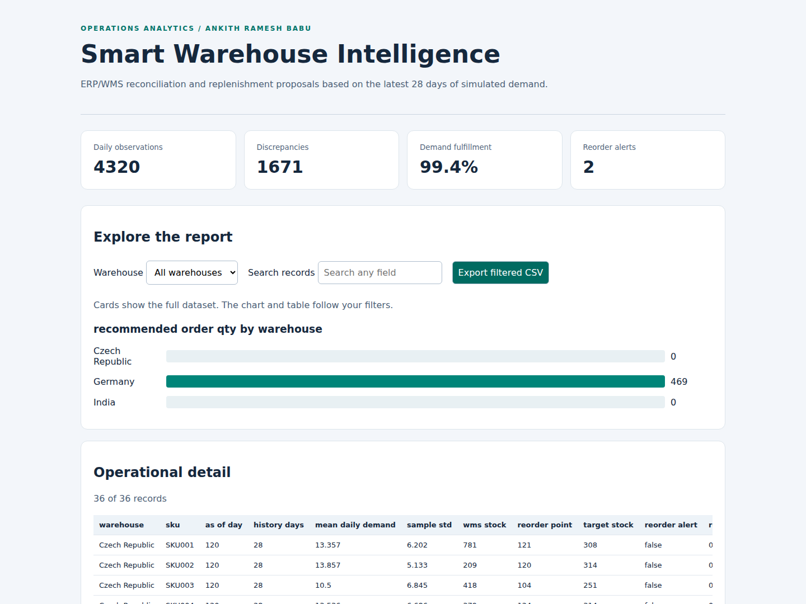

# Smart Warehouse Intelligence

Inventory reconciliation and SKU-level replenishment analysis across three warehouses, combining daily stock checks with demand-based order proposals.

**Author:** Ankith Ramesh Babu  
**Scope:** Independent case study using synthetic operational data

**Locations:** Germany, Czech Republic and India

[IEEE-format Report](reports/project-report.pdf) · [Power BI project](powerbi/Warehouse.pbip) · [Methodology](docs/methodology.md)



## Key Results

The baseline contains 4,320 daily observations and 36 warehouse-SKU pairs. It identifies 1,671 ERP/WMS discrepancies, 99.42% demand fulfillment and two final replenishment proposals totaling 469 units. A lead-time sensitivity analysis increases the proposed quantity from 280 units at three days to 836 units at fourteen days.

These results describe the simulation, not an employer operation or measured business savings.

## Project Deliverables

- [IEEE-format technical report](reports/project-report.pdf): six-page IEEEtran paper with an abstract, index terms, methodology, results, dashboard screenshots, code excerpts and numbered references.
- [Offline HTML dashboard](reports/dashboard.html): warehouse filter, text search and filtered CSV export. Download the repository to open HTML locally.
- [Inventory reconciliation dashboard](reports/reconciliation.html): daily ERP/WMS record review.
- [Power BI source](powerbi/README.md): two report pages, visual definitions, typed semantic model and embedded dataset.
- [Scenario evidence](reports/analysis.json): lead-time sensitivity and regional reconciliation totals.
- [Data dictionary](docs/data-dictionary.md): row definitions, column meanings and aggregation rules.
- [Validation record](docs/validation.json): browser and source validation scope.

## Reproduce the Analysis

Python 3.11 or newer. The analysis has no third-party dependencies.

```bash
git clone https://github.com/ankithr457/smart-warehouse-intelligence.git
cd smart-warehouse-intelligence
python src/run.py
python scripts/analyze.py
python -m unittest discover -s tests -v
```

Open `reports/dashboard.html`. The HTML works offline. Cards display the full dataset. Chart and table filters apply to matching rows, and the CSV export includes every match.

## Power BI Report

Open `powerbi/Warehouse.pbip` in Power BI Desktop and refresh the embedded data. No local CSV path is required. The report and model are provided as editable source. JSON schemas, embedded-data identity and visual-field references are validated. Power BI Desktop rendering, refresh and DAX execution remain outside the completed verification scope. A PBIX binary is not included.

Regenerate the embedded source after an analysis change:

```bash
python scripts/build_powerbi.py
```

## Scenario Parameters

```bash
python src/run.py --days 180 --seed 7 --lead-time 10 --target-days 28 --output reports/scenario
```

## Repository Structure

| Directory | Contents |
| --- | --- |
| `src/` | Simulation, calculations, CSV and HTML generation |
| `scripts/` | Scenario analysis, Power BI and PDF report authoring |
| `tests/` | Business rules, edge cases, reproducibility and model checks |
| `reports/` | Baseline outputs, IEEE-format report and dashboard screenshots |
| `powerbi/` | PBIP, PBIR, semantic model and DAX measures |
| `docs/` | Methodology and validation record |

## Assumptions and Limitations

Lead time is fixed, demand variation is independent, and the policy excludes open purchase orders, minimum quantities, expiry and budget constraints. Recommendations are closing-snapshot proposals and are not fed back into the receipt simulation.

The project does not connect to SAP or execute operational transactions. The KNIME directory provides a reproduction specification, not an executed native workflow.

## Build the Technical Report

The PDF is compiled from the included IEEEtran conference source. Install TeX Live or MiKTeX, then run:

```bash
python scripts/build_report.py
```

[LaTeX source and build details](docs/ieee/README.md). The report uses an IEEE conference layout and is an independent project report, not an IEEE publication.
